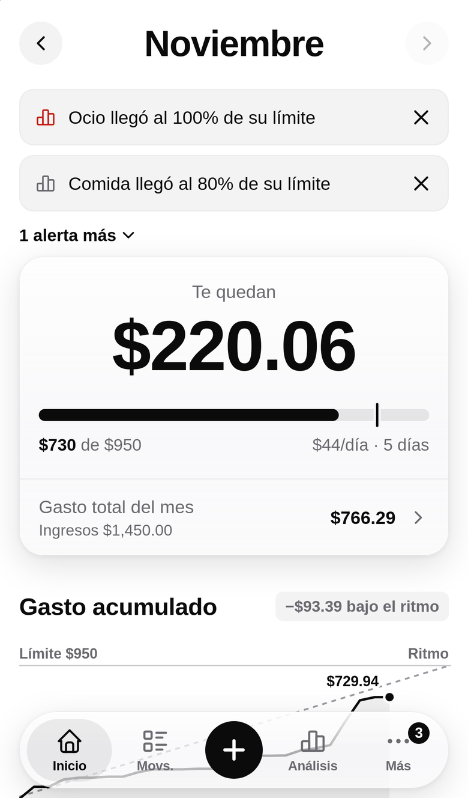
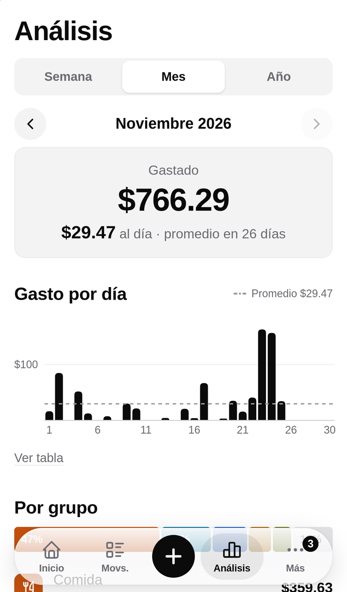
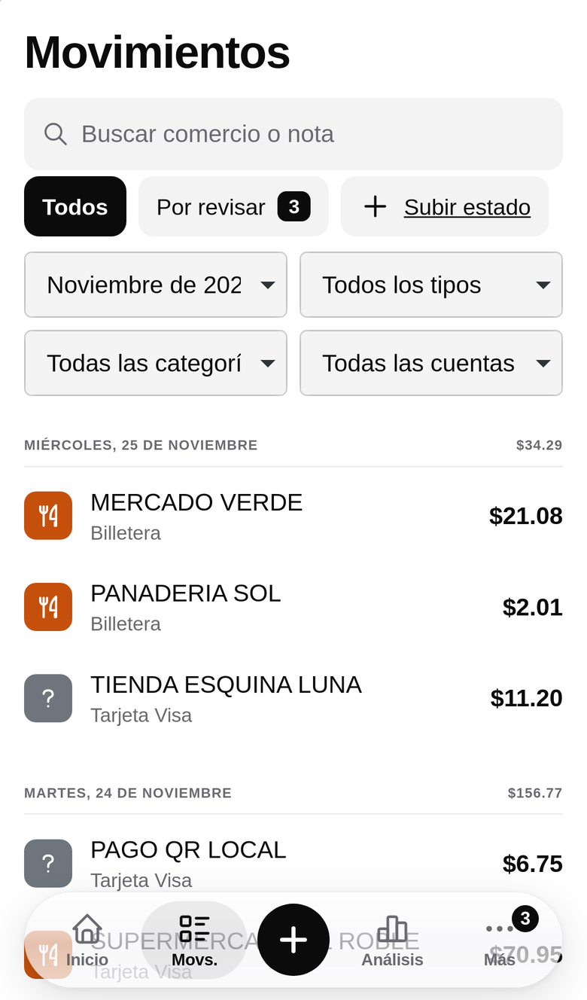
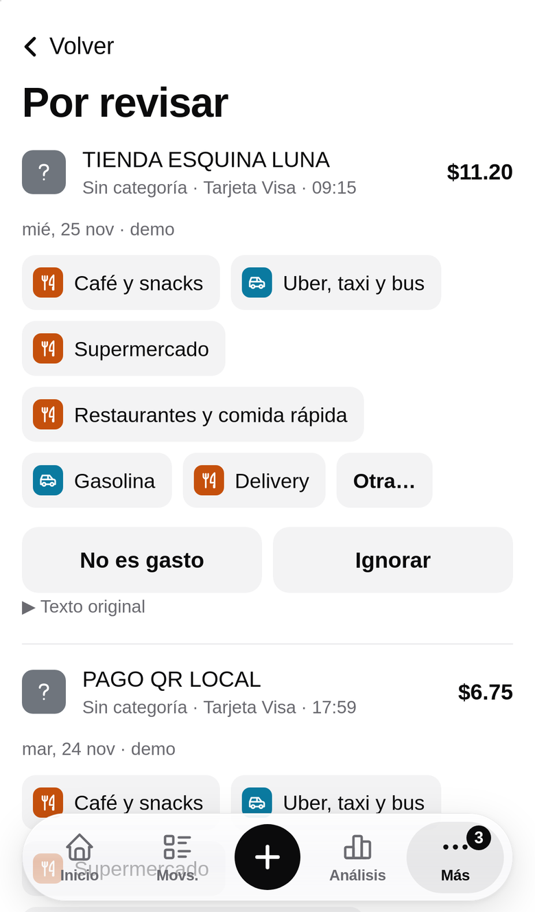

# Finanzas

A personal spending tracker that lives on the iPhone Home Screen. I built it for my own money in El Salvador (US dollars), and family members can join with an invite link. The interface is in Spanish, with English as an option.

The screenshots below use made-up demo data.

<p>
<picture><source media="(prefers-color-scheme: dark)" srcset="docs/screenshots/home-dark.png"></picture>
<picture><source media="(prefers-color-scheme: dark)" srcset="docs/screenshots/analisis-dark.png"></picture>
<picture><source media="(prefers-color-scheme: dark)" srcset="docs/screenshots/movimientos-dark.png"></picture>
<picture><source media="(prefers-color-scheme: dark)" srcset="docs/screenshots/revisar-dark.png"></picture>
</p>

## What it does

- **Home** shows what is left of the month's budget, the daily pace, spending so far against the limit, and alerts when a group reaches 80% or 100% of its limit. The budget can be monthly or weekly.
- **Análisis** has week, month and year views: spending per day, per group, and essential vs. wants vs. savings.
- **Statement import:** pick a bank PDF or CSV. The phone reads it with pdf.js in a Web Worker. Only the rows go to the server and the file is never stored. It has readers for three Salvadoran statements (BAC, Banco Agrícola, UglyCash) and a CSV reader with a column map. Every import is checked against the statement's own totals, duplicates are merged, and an import can be undone.
- **Automatic categories:** the app learns each shop from your choices and has starter rules for common shops. Anything it doesn't know waits in **Revisar**.
- **Cards:** closing and payment dates, with a reminder 3 days before payment.
- **Recurring payments**, **people** (who owes whom), and purchases in other currencies with their exchange rate.
- **Evening push alerts** through Web Push. The Worker encrypts messages itself (RFC 8291 with Web Crypto, no push package) and sends them from a daily cron trigger.
- **Accounts:** sign in with Face ID (passkeys) or a passphrase, with an optional Face ID lock and backup codes. Accounts are invite only: an invite link works once and lasts 7 days.

## How it is built

| Part | Choice |
| --- | --- |
| Server | Cloudflare Worker, Hono, Zod (strict request bodies) |
| Database | Cloudflare D1 (SQLite), 7 migrations |
| Front end | Plain HTML, CSS and ES modules. No framework and no build step. Installable web app with a service worker shell |
| Passkeys | SimpleWebAuthn |
| Statements | pdf.js 6.5 (vendored, checked by sha256), run in a Web Worker |
| Tests | Vitest inside the Workers runtime (`@cloudflare/vitest-plugin`), TypeScript type check |
| First step | `tools/`: Python scripts that read bank emails (IMAP, read only) and statements into a ledger and an HTML report. That ledger seeded the app |

## Security

Security was reviewed after every feature round. The notes are in [`app/SECURITY.md`](app/SECURITY.md).

- Every query is scoped to the signed-in user. Cookies are `__Host-` and `SameSite=Strict`, sign-in is rate limited, and sensitive changes need a fresh Face ID check.
- Strict Content Security Policy (`script-src 'self'`), cross-origin isolation, and no third-party scripts.
- 282 tests, plus an attack script ([`app/scripts/attack.py`](app/scripts/attack.py)) that runs 157 checks against a local server and a real browser: XSS payloads, one user reaching another user's data, replayed invite and reset links, the lock screen, and the offline cache.
- A privacy check ([`app/scripts/git-privacy-check.sh`](app/scripts/git-privacy-check.sh)) blocks any commit that holds real names, card numbers, emails, secrets or private files.

## Run it locally

Needs Node 22 (`app/.nvmrc`).

```sh
cd app
npm ci
npx wrangler d1 migrations apply finanzas --local
node scripts/add-user.ts demo "Demo" demo-user-local.sql --local-login demo-login.txt
npx wrangler d1 execute finanzas --local --file demo-user-local.sql
npm run dev        # http://127.0.0.1:8788, the passphrase is in demo-login.txt
```

Checks: `npm run typecheck && npm test`

To deploy your own copy, put your D1 database id, your https origin and your VAPID public key in `app/wrangler.production.jsonc`, then follow `app/README.md`. `app/scripts/deploy.sh` refuses to publish while the placeholders are still there.

## Layout

```
app/src          Worker: routes, auth, imports, alerts
app/public       Front end: screens, charts, statement readers (public/import)
app/migrations   D1 schema
app/test         Vitest suites
app/scripts      deploy, attack checks, privacy check, user and seed tools
tools            Python first step: bank emails and statements to a ledger
```

Built with Claude Code as a pair programmer.

## License

MIT, see [LICENSE](LICENSE).
